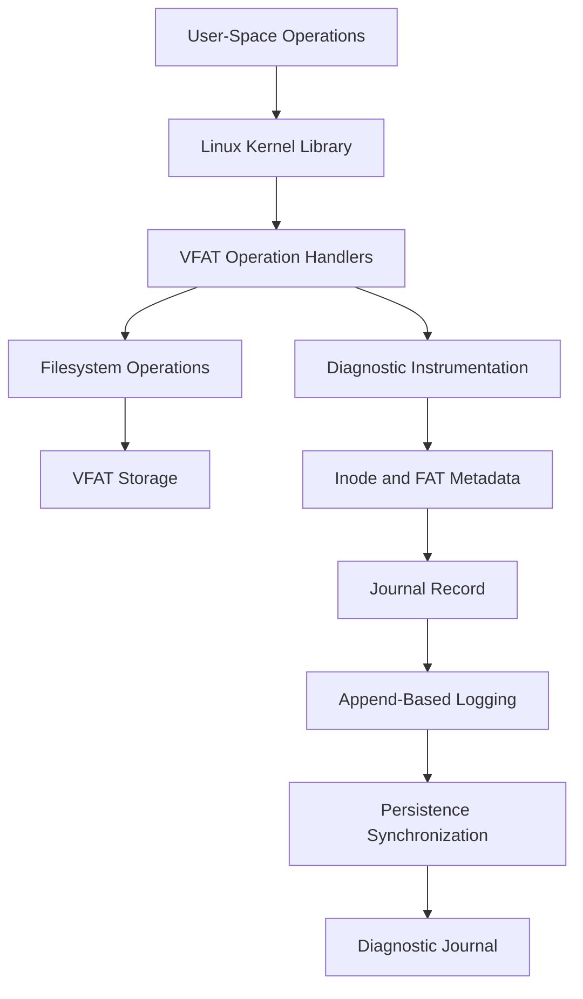

# VFAT — Linux Filesystem Diagnostic Journaling

[](https://en.wikipedia.org/wiki/C_(programming_language))
[](https://www.kernel.org/)
[](https://github.com/lkl/linux)
[]()
[]()

## Abstract

An experimental C-based extension of the VFAT filesystem within
the Linux Kernel Library (LKL), introducing diagnostic journaling
for filesystem activity, inode timestamps, and FAT metadata.

The project explores Linux filesystem internals, low-level code
instrumentation, persistent file I/O, and the engineering trade-offs
between diagnostic visibility, storage durability, and I/O overhead.

Originally developed as an Operating Systems project at the
Department of Computer Science and Engineering,
University of Ioannina.

---

## Table of Contents

- [Project Objectives](#project-objectives)
- [System Architecture](#system-architecture)
- [Core Capabilities](#core-capabilities)
- [Technical Implementation](#technical-implementation)
- [Repository Structure](#repository-structure)
- [Build and Execution](#build-and-execution)
- [Validation and Performance Evaluation](#validation-and-performance-evaluation)
- [Project Status and Limitations](#project-status-and-limitations)
- [Development Roadmap](#development-roadmap)
- [Technical References](#technical-references)
- [Contributing](#contributing)
- [Academic Attribution](#academic-attribution)
- [Authors](#authors)
- [License](#license)

---

## Project Objectives

- Extend an existing Linux filesystem implementation using C.
- Introduce diagnostic instrumentation into VFAT source code.
- Capture inode timestamps and relevant FAT metadata.
- Investigate persistent logging and filesystem synchronization.
- Preserve existing filesystem semantics during instrumentation.
- Explore the relationship between logging, reliability, and
  storage performance.

## System Architecture

The following diagram illustrates the conceptual filesystem
instrumentation and diagnostic logging workflow.



The diagnostic journal provides visibility into selected filesystem
operations. It is not a transactional crash-recovery mechanism.

## Core Capabilities

| Capability | Description |
|---|---|
| Filesystem instrumentation | Extension of existing FAT and VFAT source code. |
| Metadata collection | Recording of inode timestamps and relevant FAT metadata. |
| Diagnostic journaling | Generation of records for filesystem inspection and debugging. |
| Append-based logging | Addition of diagnostic records to a persistent log file. |
| Storage synchronization | Exploration of persistence through file synchronization operations. |
| LKL integration | Development within the Linux Kernel Library environment. |

## Technical Implementation

### Linux Kernel Library Integration

The project uses LKL to investigate and modify Linux filesystem
components within a user-space environment, without requiring
deployment of a modified native host kernel.

The repository contains selected modified source files intended
for integration into a compatible upstream LKL source tree.

### Filesystem Instrumentation

Diagnostic instrumentation is introduced into selected FAT
and VFAT components responsible for filesystem operations,
inode management, and metadata handling.

The implementation aims to collect additional diagnostic
information while preserving the original filesystem behavior.

### Diagnostic Journaling and Metadata

The logging mechanism records information associated with
selected filesystem activity, including:

- Inode timestamps.
- FAT filesystem metadata.
- Diagnostic information associated with filesystem modifications.
- Contextual records for subsequent inspection and debugging.

Records are appended to a diagnostic journal for analysis.

### Persistence and Synchronization

The project explores persistent file I/O through synchronization
operations, including:

- `fsync()` — synchronization of file data and associated metadata.
- `fdatasync()` — synchronization of file data and metadata
  required for subsequent data retrieval.

These operations introduce engineering trade-offs between
storage durability, operation latency, and I/O overhead.

Crash-recovery and durability guarantees have not been established.

### Source Code Components

| Source File | Responsibility |
|---|---|
| `src/fs/fat/fat.h` | FAT filesystem definitions and declarations. |
| `src/fs/fat/inode.c` | FAT inode management and filesystem implementation. |
| `src/fs/fat/namei_vfat.c` | VFAT name and directory-related operations. |
| `src/tools/lkl/cptofs.c` | LKL user-space filesystem utility. |

## Repository Structure

```text
Log-File-Implementation-in-the-VFAT-File-System-of-Linux/
├── docs/
│   ├── assignment.pdf        # Original project specification
│   └── report.pdf            # Academic project report
├── src/
│   ├── fs/
│   │   └── fat/
│   │       ├── fat.h
│   │       ├── inode.c
│   │       └── namei_vfat.c
│   └── tools/
│       └── lkl/
│           └── cptofs.c
├── CHANGELOG.md              # Project change history
├── CODE_OF_CONDUCT.md        # Community conduct guidelines
├── CONTRIBUTING.md           # Contribution guidelines
├── LICENSE                   # Repository licensing information
└── README.md                 # Project documentation
```

## Build and Execution

### Prerequisites

| Dependency | Purpose |
|---|---|
| GNU/Linux | Development environment |
| GCC or compatible C compiler | Source code compilation |
| GNU Make | Build automation |
| Linux Kernel Library | Filesystem integration |
| VFAT support | Target filesystem |
| Git | Version control |

### Clone the Repository

```bash
git clone https://github.com/ChristosGkovaris/Log-File-Implementation-in-the-VFAT-File-System-of-Linux.git

cd Log-File-Implementation-in-the-VFAT-File-System-of-Linux
```

### Integration and Execution

The intended development workflow consists of:

1. Obtain a compatible upstream LKL source tree.
2. Integrate the modified FAT, VFAT, and LKL source files.
3. Configure the required filesystem support and rebuild LKL.
4. Initialize an isolated VFAT filesystem image.
5. Execute filesystem operations within the LKL environment.
6. Inspect the generated diagnostic journal.

**Build status:** The compatible upstream revision and
reproducible build procedure require further verification.

This repository is not a standalone executable distribution.
Testing should use disposable filesystem images rather than
production storage devices.

## Validation and Performance Evaluation

### Functional Validation

| Test Scenario | Validation Objective |
|---|---|
| File creation and modification | Inspect associated diagnostic records. |
| File and directory operations | Investigate filesystem instrumentation coverage. |
| Timestamp updates | Compare recorded and expected inode metadata. |
| Repeated operations | Evaluate diagnostic record consistency. |
| Storage synchronization | Investigate persistence behavior. |
| Invalid operations | Evaluate error handling. |

### Performance Evaluation

A comparative evaluation of the original and modified VFAT
implementations should investigate:

| Metric | Purpose |
|---|---|
| Operation latency | Measure filesystem operation completion time. |
| I/O throughput | Evaluate storage operation efficiency. |
| Logging overhead | Quantify the additional cost of instrumentation. |
| Synchronization overhead | Evaluate the cost of persistence operations. |
| Journal growth | Measure diagnostic storage consumption. |

These tables define proposed validation procedures and
evaluation metrics, rather than verified experimental results.

No unverified performance improvements are claimed.

## Project Status and Limitations

This project is an experimental academic systems-programming
implementation.

Further verification is required in the following areas:

- Upstream LKL revision and reproducible builds.
- Filesystem operation coverage and metadata correctness.
- Concurrent filesystem behavior and resource management.
- Error handling and persistence guarantees.
- Automated regression testing.
- Quantitative performance evaluation.
- Upstream licensing compliance.

The implementation does not provide verified transactional
journaling or crash-recovery guarantees and is not intended
for production deployment.

## Development Roadmap

- [ ] Identify and document the compatible upstream LKL revision.
- [ ] Establish reproducible build and integration procedures.
- [ ] Generate reviewable patches against upstream source code.
- [ ] Review instrumentation, error handling, and resource management.
- [ ] Validate filesystem metadata and diagnostic records.
- [ ] Introduce automated filesystem regression tests.
- [ ] Evaluate logging and synchronization overhead.
- [ ] Verify upstream licensing and attribution requirements.
- [ ] Establish continuous integration where technically feasible.
- [ ] Publish reproducible validation and performance results.
- [ ] Prepare a validated, versioned software release.

## Technical References

### External Resources

- [Linux Kernel Documentation](https://docs.kernel.org/)
- [Linux Kernel Library](https://github.com/lkl/linux)
- [Linux VFAT Documentation](https://docs.kernel.org/filesystems/vfat.html)
- [Linux Virtual Filesystem Documentation](https://docs.kernel.org/filesystems/vfs.html)
- [fsync and fdatasync](https://man7.org/linux/man-pages/man2/fsync.2.html)

### Academic Documentation

- [Original Project Specification](docs/assignment.pdf)
- [Academic Project Report](docs/report.pdf)

## Contributing

Contributions related to filesystem correctness, diagnostic
instrumentation, Linux integration, testing, and technical
documentation are welcome.

Please refer to:

- [Contribution Guidelines](CONTRIBUTING.md)
- [Code of Conduct](CODE_OF_CONDUCT.md)
- [Changelog](CHANGELOG.md)

## Academic Attribution

Originally developed as part of the Operating Systems
coursework at:

**Department of Computer Science and Engineering**  
University of Ioannina  
Ioannina, Greece

**Course:** MYY601 — Operating Systems

## Authors

| Author | Affiliation | GitHub |
|---|---|---|
| Christos Gkovaris | University of Ioannina | [@ChristosGkovaris](https://github.com/ChristosGkovaris) |
| Maria Spanou | University of Ioannina | [@SpanouMaria](https://github.com/SpanouMaria) |

## License

This repository contains modifications to existing Linux
kernel and Linux Kernel Library source code.

Applicable upstream licenses and copyright notices must
be preserved. The repository-level LICENSE file does not
supersede upstream licensing obligations.

See [LICENSE](LICENSE) and individual source-file notices.
A complete licensing review remains pending.