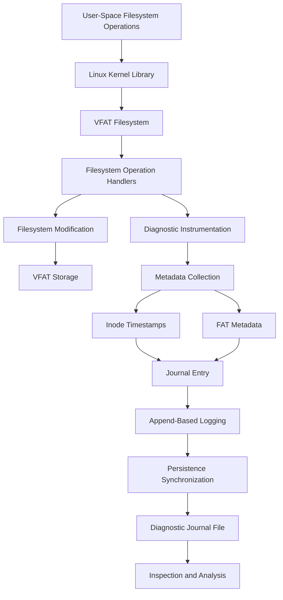

# VFAT — Linux Filesystem Diagnostic Journaling

[](https://en.wikipedia.org/wiki/C_(programming_language))
[](https://www.kernel.org/)
[](https://github.com/lkl/linux)
[]()
[]()

## Abstract

This project implements an experimental diagnostic journaling extension
for the VFAT filesystem within the Linux Kernel Library (LKL),
using the C programming language.

The implementation investigates filesystem instrumentation,
metadata tracking, persistent logging, and low-level integration
with existing Linux filesystem code.

The project aims to improve the observability of filesystem
operations by recording diagnostic information associated with
filesystem modifications, inode timestamps, and FAT metadata.

Originally developed as an Operating Systems project at the
Department of Computer Science and Engineering,
University of Ioannina.

---

## Table of Contents

- [Project Objectives](#project-objectives)
- [System Architecture](#system-architecture)
- [Core Capabilities](#core-capabilities)
- [Technical Implementation](#technical-implementation)
- [Repository Structure](#repository-structure)
- [Build and Execution](#build-and-execution)
- [Validation Methodology](#validation-methodology)
- [Project Status and Limitations](#project-status-and-limitations)
- [Development Roadmap](#development-roadmap)
- [Technical References](#technical-references)
- [Contributing](#contributing)
- [Academic Attribution](#academic-attribution)
- [Authors](#authors)
- [License](#license)

---

## Project Objectives

The primary objectives of this project are to:

- Extend existing Linux filesystem code with diagnostic logging.
- Investigate VFAT filesystem internals and operation handlers.
- Capture inode timestamps and relevant filesystem metadata.
- Record diagnostic information associated with filesystem modifications.
- Explore append-based logging and persistent storage mechanisms.
- Investigate filesystem synchronization and durability.
- Develop practical experience in low-level C programming
  and Linux kernel code maintenance.
- Evaluate the behavior of filesystem modifications within
  the Linux Kernel Library environment.

## System Architecture

The following diagram illustrates the conceptual execution
and diagnostic logging model of the project.



The conceptual architecture distinguishes filesystem operations,
metadata collection, journal record construction, and persistent
diagnostic logging.

The journal is intended for inspection and debugging rather than
transactional recovery.

## Core Capabilities

| Capability | Description |
|---|---|
| Filesystem instrumentation | Extension of existing VFAT-related source code with diagnostic logging logic. |
| Metadata collection | Recording of relevant inode and FAT filesystem information. |
| Timestamp tracking | Collection of timestamp information associated with filesystem activity. |
| Diagnostic journaling | Generation of records for filesystem inspection and debugging. |
| Append-based logging | Sequential addition of diagnostic information to a journal file. |
| Storage synchronization | Use of synchronization mechanisms intended to persist logged information. |
| LKL integration | Development within the Linux Kernel Library environment. |
| Low-level systems programming | Modification and investigation of existing Linux filesystem code. |

## Technical Implementation

### Linux Kernel Library Integration

The Linux Kernel Library provides an environment in which Linux
kernel components can be integrated into user-space applications.

The project uses this environment to investigate VFAT filesystem
behavior and extend selected filesystem-related source files
without requiring deployment of a modified native host kernel.

The repository contains selected modified source files rather
than a complete standalone Linux kernel distribution.

### VFAT Filesystem Instrumentation

The implementation extends selected VFAT-related components
to introduce diagnostic recording alongside filesystem activity.

The relevant source areas include:

- Filesystem inode management.
- VFAT directory and name-related operations.
- FAT filesystem definitions and metadata structures.
- LKL user-space filesystem tooling.

The instrumentation is intended to preserve the original
filesystem behavior while collecting additional diagnostic
information.

Behavioral equivalence with the upstream implementation has
not been formally established.

### Metadata Collection

The diagnostic logging mechanism investigates information
associated with filesystem state, including:

- Inode timestamps.
- FAT filesystem metadata.
- Information associated with filesystem modifications.
- Contextual diagnostic records.

The collected information provides visibility into selected
filesystem operations and metadata changes.

Complete coverage of all VFAT operations has not been established.

### Diagnostic Journal

The journal is designed to provide an inspectable record of
filesystem activity.

The logging approach incorporates:

- Construction of diagnostic records.
- Collection of relevant filesystem metadata.
- Append-based file operations.
- Persistent storage mechanisms.
- Subsequent inspection of recorded information.

The journal is a diagnostic mechanism and does not implement
a verified transactional filesystem recovery protocol.

### Persistence and Synchronization

The project explores filesystem persistence through
synchronization operations, including `fsync()` and `fdatasync()`.

These mechanisms are intended to reduce the risk of diagnostic
records remaining exclusively in volatile buffers.

The engineering considerations include:

- Buffered and persistent file I/O.
- Synchronization of recorded information.
- Data and metadata persistence.
- Error handling during storage operations.
- The relationship between durability and I/O overhead.

Durability under unexpected termination or storage failure
requires further verification.

### Source Code Components

| Component | Responsibility |
|---|---|
| `src/fs/fat/fat.h` | FAT filesystem definitions and related declarations. |
| `src/fs/fat/inode.c` | FAT filesystem inode-related implementation. |
| `src/fs/fat/namei_vfat.c` | VFAT name and directory-related implementation. |
| `src/tools/lkl/cptofs.c` | LKL user-space filesystem utility implementation. |

The source files represent the areas involved in the academic
filesystem extension.

## Repository Structure

```text
Log-File-Implementation-in-the-VFAT-File-System-of-Linux/
├── docs/
│   ├── assignment.pdf        # Original project specification
│   └── report.pdf            # Academic project report
├── src/
│   ├── fs/
│   │   └── fat/
│   │       ├── fat.h         # FAT definitions and declarations
│   │       ├── inode.c       # FAT inode implementation
│   │       └── namei_vfat.c  # VFAT name and directory operations
│   └── tools/
│       └── lkl/
│           └── cptofs.c     # LKL filesystem utility
├── CHANGELOG.md              # Project change history
├── CODE_OF_CONDUCT.md        # Community conduct guidelines
├── CONTRIBUTING.md           # Contribution guidelines
├── LICENSE                   # Repository licensing information
└── README.md                 # Project documentation
```

## Build and Execution

### Prerequisites

The intended development environment consists of:

| Dependency | Purpose |
|---|---|
| GNU/Linux | Target development environment |
| GCC or compatible C compiler | Source code compilation |
| GNU Make | Build automation |
| Linux Kernel Library | Filesystem integration environment |
| VFAT filesystem support | Target filesystem implementation |
| Git | Version control |

### Clone the Repository

```bash
git clone https://github.com/ChristosGkovaris/Log-File-Implementation-in-the-VFAT-File-System-of-Linux.git

cd Log-File-Implementation-in-the-VFAT-File-System-of-Linux
```

### Integration and Compilation

The repository contains selected source files intended for
integration into a compatible Linux Kernel Library source tree.

The original development workflow consists of:

1. Obtain the appropriate LKL source tree.
2. Identify the corresponding upstream VFAT source files.
3. Integrate the modified source files.
4. Configure the required filesystem support.
5. Rebuild LKL using its build system.
6. Prepare an isolated filesystem test environment.

**Build status:** The compatible upstream revision, dependency
configuration, and reproducible build procedure require
further verification.

The repository is not currently presented as a standalone,
directly executable software distribution.

### Execution Workflow

Once the modified LKL environment has been successfully built:

1. Prepare a disposable VFAT filesystem image.
2. Initialize the LKL user-space environment.
3. Execute filesystem operations within the test image.
4. Inspect the resulting diagnostic journal.
5. Compare recorded metadata against expected filesystem behavior.
6. Investigate missing, inconsistent, or unexpected records.

Testing should be performed using isolated filesystem images
rather than production storage devices.

## Validation Methodology

A reproducible evaluation should investigate both filesystem
behavior and diagnostic logging correctness.

### Functional Validation

| Test Scenario | Validation Objective |
|---|---|
| File creation | Investigate associated metadata and diagnostic records. |
| File modification | Evaluate logging behavior during file updates. |
| File deletion | Investigate diagnostic information associated with removal. |
| Directory creation | Examine directory-related filesystem activity. |
| Timestamp updates | Compare recorded timestamps with expected inode state. |
| Repeated operations | Investigate consistency and ordering of journal entries. |
| Storage synchronization | Evaluate persistence behavior after synchronization. |
| Invalid operations | Investigate error handling and unexpected conditions. |

These scenarios represent proposed validation procedures,
not a claim that an automated test suite has been executed.

### Reliability Evaluation

Further reliability evaluation should investigate:

- Diagnostic record completeness.
- Metadata accuracy.
- Error propagation.
- Concurrent filesystem activity.
- Logging-related resource management.
- Behavior under storage failures.
- Unexpected process termination.

### Performance Evaluation

The diagnostic logging mechanism may introduce additional
filesystem I/O and synchronization overhead.

A structured evaluation should compare the original VFAT
implementation against the modified implementation using:

| Metric | Purpose |
|---|---|
| Operation latency | Evaluate the time required for filesystem operations. |
| Logging overhead | Investigate the additional cost of diagnostic recording. |
| I/O throughput | Compare storage operation efficiency. |
| Synchronization overhead | Evaluate the cost of persistence operations. |
| Journal growth | Measure storage consumption over repeated workloads. |

Performance results should include the operating environment,
LKL revision, filesystem configuration, workload parameters,
and measurement methodology.

No unverified performance improvements or durability
guarantees are claimed.

## Project Status and Limitations

This project is an experimental academic Linux
systems-programming implementation.

The following areas require further verification or development:

- Identification of the compatible upstream LKL revision.
- Reproducible compilation and integration procedures.
- Verification of filesystem operation coverage.
- Metadata and timestamp correctness.
- Memory safety and resource management.
- Concurrent filesystem behavior.
- Error handling and persistence guarantees.
- Automated regression testing.
- Quantitative performance evaluation.
- Upstream source-code licensing compliance.

The diagnostic journal does not constitute a verified
transactional journaling filesystem and does not provide
established crash-recovery guarantees.

The implementation is not intended for production deployment.

## Development Roadmap

- [ ] Identify and document the compatible upstream LKL revision.
- [ ] Establish reproducible build and integration instructions.
- [ ] Generate reviewable patches against the upstream source tree.
- [ ] Review filesystem instrumentation and resource management.
- [ ] Validate metadata and timestamp collection.
- [ ] Investigate error handling and synchronization behavior.
- [ ] Establish automated filesystem regression tests.
- [ ] Evaluate diagnostic logging and persistence overhead.
- [ ] Verify upstream licensing and attribution requirements.
- [ ] Establish continuous integration where technically feasible.
- [ ] Publish reproducible validation and performance results.
- [ ] Prepare a validated, versioned software release.

## Technical References

### External Resources

- [Linux Kernel Documentation](https://docs.kernel.org/)
- [Linux Kernel Library](https://github.com/lkl/linux)
- [Linux VFAT Documentation](https://docs.kernel.org/filesystems/vfat.html)
- [Linux Virtual Filesystem Documentation](https://docs.kernel.org/filesystems/vfs.html)
- [fsync and fdatasync](https://man7.org/linux/man-pages/man2/fsync.2.html)

### Academic Documentation

- [Original Project Specification](docs/assignment.pdf)
- [Academic Project Report](docs/report.pdf)

## Contributing

Contributions related to filesystem correctness,
diagnostic instrumentation, Linux integration,
resource management, testing, and technical
documentation are welcome.

Please refer to the following documents before
submitting changes:

- [Contribution Guidelines](CONTRIBUTING.md)
- [Code of Conduct](CODE_OF_CONDUCT.md)
- [Changelog](CHANGELOG.md)

## Academic Attribution

This project was originally developed as part of the
Operating Systems coursework at:

**Department of Computer Science and Engineering**  
University of Ioannina  
Ioannina, Greece

**Course:** MYY601 — Operating Systems

## Authors

| Author | Affiliation | GitHub |
|---|---|---|
| Christos Gkovaris | University of Ioannina | [@ChristosGkovaris](https://github.com/ChristosGkovaris) |
| Maria Spanou | University of Ioannina | [@SpanouMaria](https://github.com/SpanouMaria) |

## License

This repository contains modifications to existing Linux
kernel and Linux Kernel Library source code.

The applicable upstream licenses and copyright notices
must be preserved. The repository-level LICENSE file
does not supersede licensing requirements associated
with upstream source files or derivative works.

See the [LICENSE](LICENSE) file and the individual
source-file licensing notices for further information.

A complete licensing review remains pending.